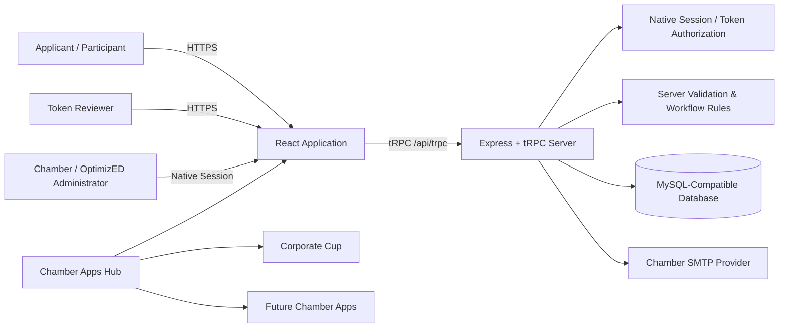

# Technical Architecture

## System Purpose

The FMWF Chamber Application Management Platform is a configurable multi-program system for public applications, nominations, registrations, account-free reviewer scoring, staff decisions, editable communications, annual archives, exports, and event operations. The initial production configuration covers Leadership FMWF, The Awards / Chamber Choice Awards, and Military Appreciation Night. Additional uses, including hiring/application workflows, are supported when they fit the existing configurable structures.

## Technology Stack

| Layer | Technology | Primary Source |
|---|---|---|
| Browser | React 19, TypeScript, Wouter, Tailwind CSS 4, Radix/shadcn | `client/src/` |
| API | tRPC 11 with SuperJSON | `server/routers.ts`, `client/src/lib/trpc.ts` |
| Server | Express 4 on Node 22 | `server/_core/index.ts` |
| Persistence | Drizzle ORM with MySQL/TiDB | `drizzle/schema.ts`, `server/db.ts` |
| Staff authentication | Native username/password sessions, scrypt hashes, lockout, activation, forced password change | `server/nativeAuth.ts`, `server/routers.ts`, `server/_core/sdk.ts` |
| Reviewer/participant access | Unguessable token links; no account registration | `server/routers.ts`, `drizzle/schema.ts` |
| Email | Nodemailer with administrator-configured SMTP and encrypted stored password | `server/smtpService.ts`, `server/emailNotifications.ts` |
| Tests | Vitest standard and opt-in database acceptance | `server/*.test.ts` |
| Build | Vite frontend plus esbuild server bundle | `package.json` |

## Runtime Flow

All critical public, scoring, approval, participant, check-in, waitlist, and authorization rules are enforced on the server.

## Authorization Model

| Access Type | Authentication | Scope |
|---|---|---|
| Applicant | None | Open program information, public submission, confirmation number |
| Status lookup | Confirmation number | Limited application status result |
| Reviewer | Unique reviewer token | Assigned applications and permitted scoring actions |
| Accepted participant | Unique participant token | One accepted registration’s participant/commander form |
| Chamber/OptimizED administrator | Native username/password session | Full staff administration, subject to active account and password-change controls |
| Demo administrator | Explicit server flag and separate server credentials | Demonstration only; disabled in production |

Native passwords use salted scrypt hashes. Five failed sign-ins create a timed lock. Authorized administrators can unlock, reset, activate, or deactivate accounts. A bootstrap administrator must replace the temporary password. The browser never receives a password hash. `adminProcedure` rejects inactive native accounts and accounts that still require a password change.

## Principal Routes

### Public and Token Routes

| Route | Purpose |
|---|---|
| `/` | Open programs and dynamic deadlines |
| `/staff-login` | Native Chamber administrator sign-in |
| `/change-password` | Required temporary-password replacement |
| `/apply/:slug` | Public configurable application/nomination/registration form |
| `/confirmation/:applicationNumber` | Submission confirmation |
| `/status` | Confirmation-number status lookup |
| `/participant-form/:token` | Secure accepted participant/commander follow-up |
| `/review/:token` | Account-free reviewer portal |
| `/review/:token/application/:applicationId` | Assigned reviewer scoring screen |

### Administrator Routes

| Route | Purpose |
|---|---|
| `/admin` | Dashboard |
| `/admin/programs` | Program cards, add/duplicate/configure, copy links |
| `/admin/programs/:id` | Form Builder and Scoring Criteria |
| `/admin/programs/:programId/applications` | Submitted applications and review status |
| `/admin/programs/:id/settings` | Deadlines, rules, capacity, participant/check-in/waitlist controls |
| `/admin/programs/:id/email-templates` | Program communication templates |
| `/admin/programs/:programId/checkins` | Accepted-only event check-in |
| `/admin/programs/:programId/waitlist` | Waitlist and manual promotion |
| `/admin/programs/:programId/export` | CSV, Excel, printable PDF |
| `/admin/staff-accounts` | Native administrator account management |
| `/admin/reviewers` | Reviewer directory and token access |
| `/admin/reviewer-progress` | Assignment completion tracking |
| `/admin/archives` | Annual snapshots and viewer |
| `/admin/flags` | Cross-year applicant flags/restrictions |
| `/admin/smtp-settings` | Chamber SMTP and sender configuration |
| `/admin/guided-tour`, `/admin/help` | Guided Tour and Help Center |

Legacy Form Builder, Email Template, Export, and reviewer URL aliases redirect to canonical routes.

## Core Data Domains

| Domain | Records and Relationships |
|---|---|
| Identity | Native usernames, password hashes, activation, forced-change, lockout, admin role, sessions |
| Programs | Type, year, status, form JSON, scoring JSON, email JSON, feature settings |
| Applications | Program, confirmation number, form JSON, contact data, status, score aggregate, participant token |
| Review | Reviewer directory/token, assignments, criteria scores, comments, completion state |
| Event operations | Participant/commander form, attendees, T-shirts, check-in state/notes, waitlist position/status |
| Governance | Applicant flags, annual archives, SMTP/system settings |

## Critical Workflow Rules

The submission server requires an open program, evaluates Central Time deadlines, enforces configured required and conditional fields, rejects active restrictions where configured, and optionally waitlists a registration only when accepted allocation has reached capacity.

Reviewers see assigned records. Blind review removes identifying data. The server validates each criterion, review deadline, score-edit toggle, and mandatory low-score comments, then recalculates aggregates after every valid score change.

Staff make every acceptance decision manually. Registration approval produces a secure participant link. The participant endpoint validates token, application/program relationship, accepted status, enabled feature, and duplicate protection before storing T-shirt, guest, pronunciation, commander, service, and attendee details.

Military Night never automatically approves or fulfills first-come. Capacity-based waitlisting uses accepted allocation. Promotion remains administrator-controlled unless a separate optional promotion setting is affirmatively enabled.

Only accepted registrations appear in Check-In. Staff can mark Picked Up, Cancelled, or No-Show, add notes, undo mistakes, and optionally create a future-eligibility flag after a no-contact No-Show.

## Email and Secret Handling

Program templates control confirmation, reviewer assignment, reminder, and status messages. SMTP configuration is administrator-managed. The stored password is encrypted with AES-256-GCM using a key derived from `JWT_SECRET`; the configuration API returns only a mask. Core workflows persist even if SMTP is disabled.

`JWT_SECRET` must accompany encrypted database restores. All reviewer and participant links are built from `PUBLIC_APP_URL`.

## Export and Archive Boundaries

CSV, Excel, and printable PDF can include application responses, ranking, each reviewer’s criteria scores/comments, participant/commander/attendee/T-shirt data, check-in, and waitlist data. Annual archives are historical snapshots for viewing, not database rollback. Provider backup/restore remains a separate operational process.

## Known Boundaries

The Platform does not include automatic applicant approval, first-come ticket fulfillment, an Interview/Calendar module, public applicant accounts, secure applicant file upload, 24/7 monitoring, or guaranteed third-party email delivery. Materially new modules, integrations, migrations, or data models require maintenance review or separately approved scope.

## Verified Baseline

The current source passes TypeScript, a production build, **67 standard tests**, mobile/desktop rendering, and two opt-in database-backed acceptance suites. The first exercises the full native staff-account lifecycle. The second exercises submission, two-reviewer scoring/editing, approval, participant data, check-in, waitlist promotion, status, and export. Both suites remove their temporary records.

Production acceptance must repeat native login and account administration, SMTP, DNS/HTTPS, full workflows, mobile use, and backup/restore in the selected production environment.
